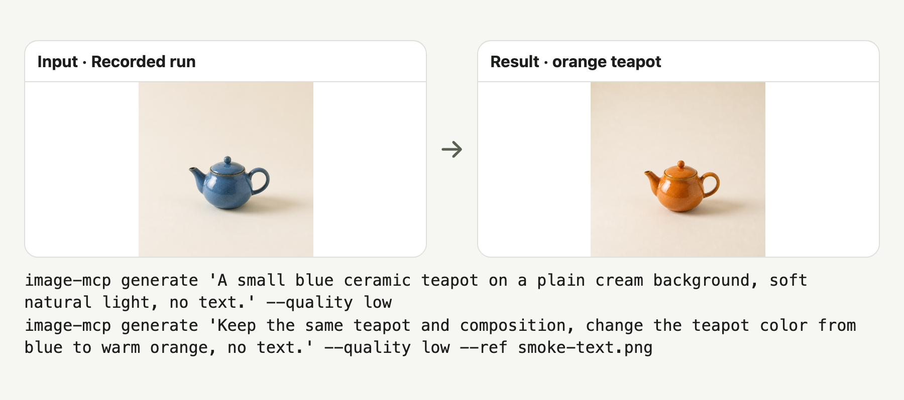

# image-mcp

Developers: generate and edit local images from your AI agent through an OpenAI-compatible API.

[简体中文](README.md)

<picture>
  <source media="(prefers-color-scheme: dark)" srcset="docs/readme/hero-dark.png">
  
</picture>

Recorded results: prompt → blue teapot; reference → orange teapot, both at `low`. [Images, commands and reproduction](docs/readme/demo.md).

## Quick start

List 21 styles without an API key:

```sh
uvx --from git+https://github.com/bmdy6/image-mcp image-mcp styles
```

Requires [uv](https://docs.astral.sh/uv/getting-started/installation/) and Python ≥3.10; dependencies install on first use. Listing styles needs no key.

```sh
export OPENAI_API_KEY="YOUR_OPENAI_API_KEY"
uvx --from git+https://github.com/bmdy6/image-mcp image-mcp generate "A blue ceramic teapot" --quality low
```

Generation needs a valid key, network and Images API access. Results default to `image-mcp-output/` in the current directory.

## MCP configuration

Ensure the client can find `uvx` on PATH, replace the key placeholder, then restart or reconnect MCP. All three launch the same stdio server from GitHub `main`.

### Claude Code

Use `.mcp.json` in the project root and approve the project MCP when prompted.

```json
{
  "mcpServers": {
    "image-mcp": {
      "command": "uvx",
      "args": [
        "--from",
        "git+https://github.com/bmdy6/image-mcp",
        "image-mcp",
        "mcp"
      ],
      "env": {
        "OPENAI_API_KEY": "YOUR_OPENAI_API_KEY"
      }
    }
  }
}
```

### Codex

Add to `~/.codex/config.toml`.

```toml
[mcp_servers.image-mcp]
command = "uvx"
args = ["--from", "git+https://github.com/bmdy6/image-mcp", "image-mcp", "mcp"]

[mcp_servers.image-mcp.env]
OPENAI_API_KEY = "YOUR_OPENAI_API_KEY"
```

### Cursor

Use `.cursor/mcp.json` in the project.

```json
{
  "mcpServers": {
    "image-mcp": {
      "command": "uvx",
      "args": [
        "--from",
        "git+https://github.com/bmdy6/image-mcp",
        "image-mcp",
        "mcp"
      ],
      "env": {
        "OPENAI_API_KEY": "YOUR_OPENAI_API_KEY"
      }
    }
  }
}
```

Ask your agent: “Call `list_styles`, then generate a blue teapot with style `product` and quality `low`.” Generation is paid; `list_styles` and `search_reference_images` do not call the image API.

Configuration references: [Claude Code](https://code.claude.com/docs/en/mcp), [Codex](https://developers.openai.com/codex/mcp), [Cursor](https://cursor.com/docs/mcp).

## What you get

- Generate local PNG images from prompts or references, returning absolute paths, actual dimensions, style and final prompt.
- List and apply 21 built-in Chinese style templates.
- Search original local examples for titles, styles, tags and sample prompts.

## How it works

1. Choose with `list_styles()` or find examples with `search_reference_images(query, limit)`.
2. Call `generate_image(prompt, reference_image?, aspect_ratio?, style?, quality?)`.
3. Open the local PNG at the returned `path`; the CLI returns the same JSON fields.

## Commands / options

| Command / option | Purpose |
|---|---|
| `generate "prompt"` | Generate; `--ref` accepts a local image or public HTTPS URL. |
| `--style` | Template id; default `default`. |
| `--ratio` / `--quality` | Default `1:1` / `low`; see limits below. |
| `styles` / `search "海报" --limit 3` | List styles or search local examples offline. |
| `mcp` | Start the stdio server. |

## 21 styles

| id | Chinese name | Description |
|---|---|---|
| `default` | 默认 | Fill unspecified visual details while preserving explicit requirements. |
| `real` | 真实摄影 | Use photographic lighting, texture and composition. |
| `product` | 商业产品 | Create clean commercial product imagery. |
| `tech_poster` | 科技海报 | Arrange a technology poster with clear hierarchy. |
| `travel` | 旅行杂志 | Use travel-magazine composition and atmosphere. |
| `travel_guide` | 旅行手账 | Organize a travel journal or illustrated guide. |
| `interior` | 室内空间 | Show interiors with coherent space and materials. |
| `live_stream` | 直播界面 | Compose a readable live-stream interface. |
| `silhouette` | 叙事剪影 | Tell a scene through silhouettes and contrast. |
| `silk_road` | 丝路绘画 | Use Silk Road painting motifs and colors. |
| `vintage_5s` | 复古胶片 | Emulate nostalgic film texture. |
| `ccd_snap` | 日常抓拍 | Use a casual compact-camera snapshot aesthetic. |
| `relation_map` | 关系图谱 | Lay out entities and their relationships. |
| `encyclopedia` | 百科图鉴 | Present a subject as an illustrated encyclopedia. |
| `restore_old` | 旧照修复 | Guide an old-photo restoration. |
| `ui_upgrade` | 界面重绘 | Guide a visual interface redraw. |
| `knowledge_card` | 知识卡片 | Arrange information as a knowledge card. |
| `product_detail` | 商品详情 | Compose a product-detail page. |
| `app_ui_design` | 应用界面 | Draft an application interface. |
| `campaign_poster` | 活动海报 | Structure a promotional event poster. |
| `virtual_tryon` | 虚拟试衣 | Guide a clothing try-on image. |

## Environment variables

| Variable | Default and purpose |
|---|---|
| `OPENAI_API_KEY` | Required for generation; supply your own key. |
| `OPENAI_BASE_URL` | `https://api.openai.com/v1`; an OpenAI-compatible Images endpoint can be used. |
| `IMAGE_MODEL` | `gpt-image-2`; your endpoint must support the model. |
| `IMAGE_MCP_OUTPUT_DIR` | `./image-mcp-output`, relative to the server process working directory. |
| `IMAGE_MCP_ALLOW_FAKE_IP` | Off by default; set `1` only for a confirmed proxy fake-IP setup. Allows `198.18.0.0/15`; other private addresses remain blocked. |

## FAQ / limitations

### What does it cost?

Every generation is billed to your key; `low` is cheapest. `medium`, `high` and `auto` are also supported. Prices depend on the provider, model and size; provider rules govern failed requests.

### Which references are accepted?

URL references allow public HTTPS only; every redirect is checked against private, loopback and link-local addresses. Local and downloaded images must be static PNG, JPEG, WebP or GIF, at most 20 MB, 40 million pixels and 8192 pixels per edge. References above 2048 pixels per edge are resized proportionally and sent to your configured API.

### What are the output limits?

`1:1` requests 1024×1024. `9:16`, `2:3` and `3:4` all request 1024×1536; `16:9`, `3:2` and `4:3` request 1536×1024. Returned dimensions reflect the actual image; ratios are approximate.

Each call saves one PNG, with no cloud URL.

### Do presets or search guarantee results?

Presets append prompt hints; restoration and try-on are model instructions rather than dedicated algorithms. Search covers 21 original local text examples, with no web search or preview images.

Only a local CLI and stdio MCP are provided, without a hosted UI, accounts or cloud storage. API requests do not use proxy environment variables.

## Contributing

Describe reproduction steps in [Issues](https://github.com/bmdy6/image-mcp/issues) and test against a fake backend; keep keys and private images out of commits.

```sh
uv run --extra test python -m pytest -q
```

## License

[MIT](LICENSE).
