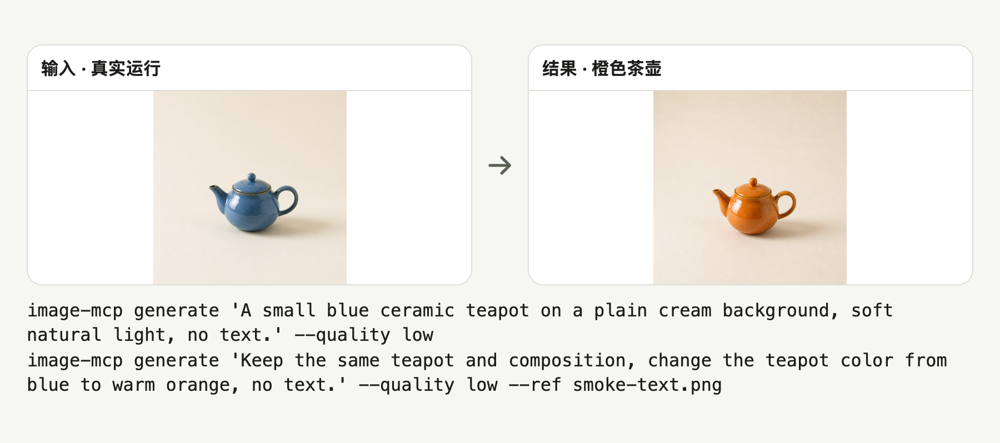

# image-mcp

给 AI agent 用的本地生图 MCP，支持文生图、参考图编辑，以及[同一角色换姿势或服装](#同一角色换姿势或服装)。

[English](README.en.md)

<picture>
  <source media="(prefers-color-scheme: dark)" srcset="docs/readme/hero-dark.zh-CN.png">
  
</picture>

真实结果：提示词生成蓝壶，再参考它改成橙壶；均为 `low`。[原图、命令与复现说明](docs/readme/demo.md)。

## 快速开始

```sh
uvx --from git+https://github.com/bmdy6/image-mcp image-mcp styles
```

以上命令列出 21 种风格，不需要 Key。

需要 [uv](https://docs.astral.sh/uv/getting-started/installation/) 和 Python ≥3.10；首次运行会安装依赖。列风格不需要 key。

```sh
export OPENAI_API_KEY="YOUR_OPENAI_API_KEY"
uvx --from git+https://github.com/bmdy6/image-mcp image-mcp generate "A blue ceramic teapot" --quality low
```

上面的 API 生图命令需要有效的 Key、网络和 Images 接口权限，结果默认保存在当前目录的 `image-mcp-output/`。

## MCP 配置

先确认客户端能在 PATH 找到 `uvx`。三种配置都从 GitHub 的 `main` 启动同一个 stdio 服务。已有安装可以用下方命令刷新缓存，再重启客户端或重新连接 MCP。

```sh
uvx --refresh --from git+https://github.com/bmdy6/image-mcp image-mcp styles
```

### Claude Code

写入项目根目录的 `.mcp.json`；按客户端提示批准项目 MCP。

```json
{
  "mcpServers": {
    "image-mcp": {
      "command": "uvx",
      "args": [
        "--from",
        "git+https://github.com/bmdy6/image-mcp",
        "image-mcp",
        "mcp"
      ],
      "env": {
        "OPENAI_API_KEY": "YOUR_OPENAI_API_KEY"
      }
    }
  }
}
```

### Codex

写入 `~/.codex/config.toml`。这段配置可以直接用来准备参考图，再交给 Codex 内置生图。

```toml
[mcp_servers.image-mcp]
command = "uvx"
args = ["--from", "git+https://github.com/bmdy6/image-mcp", "image-mcp", "mcp"]
```

如果还想从 Codex 调用 `generate_image` 走 API，在同一文件里加入下面这段，并替换占位符。

```toml
[mcp_servers.image-mcp.env]
OPENAI_API_KEY = "YOUR_OPENAI_API_KEY"
```

### Cursor

写入项目的 `.cursor/mcp.json`。

```json
{
  "mcpServers": {
    "image-mcp": {
      "command": "uvx",
      "args": [
        "--from",
        "git+https://github.com/bmdy6/image-mcp",
        "image-mcp",
        "mcp"
      ],
      "env": {
        "OPENAI_API_KEY": "YOUR_OPENAI_API_KEY"
      }
    }
  }
}
```

想试 API 生图，可以说「用 Image MCP 的 `generate_image` 画一张蓝色茶壶，风格 `product`，画质 `low`」。`list_styles`、`search_reference_images` 和 `prepare_pose_image` 无需 Key。

配置格式参考：[Claude Code](https://code.claude.com/docs/en/mcp)、[Codex](https://developers.openai.com/codex/mcp)、[Cursor](https://cursor.com/docs/mcp)。

## 你会得到什么

- 提示词或参考图都能生成本地 PNG，并返回绝对路径、实际尺寸、风格与最终提示词。
- 按姿势线稿给同一角色换动作，或同时参考另一张图换装。
- 21 种中文风格模板可直接列出并用于生成。
- 离线检索原创参考案例，获得标题、风格、标签和示例提示词。

## 工作流程

1. 调用 `list_styles()` 选模板，或用 `search_reference_images(query, limit)` 查示例。
2. 调用 `generate_image`。单张参考图用 `reference_image`，多张参考图用 `reference_images`，最多 4 张。
3. 从返回的 `path` 打开本地 PNG；CLI 输出同样的 JSON 字段。

### 同一角色换姿势或服装

| 原始角色 | 挥手 | 双臂展开 |
| --- | --- | --- |
|  |  |  |

两张结果都由 Codex 内置生图生成，分别使用同一张[角色图](docs/readme/pose-character.png)和[挥手线稿](docs/readme/pose-wave-guide.png)或[双臂展开线稿](docs/readme/pose-arms-wide-guide.png)。动作跟随线稿，配色和胸前星星得到保留，腿部比例有变化。

把角色图和姿势线稿存到本地，然后在 Codex 里试一句。

> 用 Image MCP 的 `prepare_pose_image` 准备 `pose-character.png` 和 `pose-wave-guide.png`，保留角色的脸、衣服和配色，再用 `$imagegen` 出图。

工具接收本地图的绝对路径，可选填服装图 `outfit_image` 和画面要求 `extra_prompt`。它会返回提示词 `prompt` 和按角色、服装（可选）、姿势排列的 `reference_images`。

有内置生图权限的 Codex 会话可直接使用这两项，出图用量按 Codex 登录方式结算。选择 API 出图时，将两项传给 `generate_image`。服务商须支持 Images API 多图编辑，费用按配置的 API Key 结算。 [Codex 生图文档](https://learn.chatgpt.com/docs/image-generation)

参考图按用途排列的做法来自 [澜姿](https://github.com/wzc520pyfm/gen-ai-pose-image)。请使用自己的参考图或已获授权的素材。

## 命令与选项

| 命令或参数 | 用途 |
|---|---|
| `generate "prompt"` | 生成。可按顺序重复 `--ref`，每项接受本地图片或公网 HTTPS 链接。 |
| `--style` | 模板 id，默认 `default`。 |
| `--ratio` / `--quality` | 默认 `1:1` / `low`；完整取值见下方限制。 |
| `styles` / `search "海报" --limit 3` | 离线列模板、查案例。 |
| `mcp` | 启动 stdio 服务。 |

## 21 种风格

| id | 中文名 | 一句话 |
|---|---|---|
| `default` | 默认 | 补充未说明的视觉细节，保留明确要求。 |
| `real` | 真实摄影 | 采用摄影光线、质感与构图。 |
| `product` | 商业产品 | 组织干净的商业产品画面。 |
| `tech_poster` | 科技海报 | 组织科技主题海报与信息层级。 |
| `travel` | 旅行杂志 | 营造旅行杂志的构图与氛围。 |
| `travel_guide` | 旅行手账 | 组织旅行手账或插画攻略。 |
| `interior` | 室内空间 | 表现连贯的室内空间与材质。 |
| `live_stream` | 直播界面 | 组织清晰的直播界面。 |
| `silhouette` | 叙事剪影 | 通过剪影与明暗讲述场景。 |
| `silk_road` | 丝路绘画 | 采用丝路绘画的元素与色彩。 |
| `vintage_5s` | 复古胶片 | 营造怀旧胶片质感。 |
| `ccd_snap` | 日常抓拍 | 采用日常数码相机抓拍风格。 |
| `relation_map` | 关系图谱 | 整理实体及其关系。 |
| `encyclopedia` | 百科图鉴 | 以百科图鉴形式呈现主题。 |
| `restore_old` | 旧照修复 | 引导修复老照片。 |
| `ui_upgrade` | 界面重绘 | 引导界面视觉重绘。 |
| `knowledge_card` | 知识卡片 | 将信息组织为知识卡片。 |
| `product_detail` | 商品详情 | 组织商品详情页面。 |
| `app_ui_design` | 应用界面 | 绘制应用界面。 |
| `campaign_poster` | 活动海报 | 组织活动宣传海报。 |
| `virtual_tryon` | 虚拟试衣 | 引导服装虚拟试穿。 |

## 环境变量

| 变量 | 默认值与用途 |
|---|---|
| `OPENAI_API_KEY` | 使用 Image MCP 调 API 出图时必填。 |
| `OPENAI_BASE_URL` | `https://api.openai.com/v1`，可设为 OpenAI 兼容 Images 接口。 |
| `IMAGE_MODEL` | `gpt-image-2`；接口必须支持该模型。 |
| `IMAGE_MCP_OUTPUT_DIR` | `./image-mcp-output`，相对服务进程的工作目录。 |
| `IMAGE_MCP_ALLOW_FAKE_IP` | 默认关闭；仅确认代理 fake-ip 后设 `1`，额外放行 `198.18.0.0/15`，其他内网仍拦截。 |

## 常见问题与限制

### 如何计费？

Image MCP 的 API 出图按配置的 Key 结算，价格取决于服务商、模型、尺寸和画质。Codex 内置生图按当前会话的登录方式结算。

### 参考图安全吗？

链接只读公网 HTTPS，每次重定向都会检查并拦截内网、回环及链路本地地址。本地文件与下载图片均需为静态 PNG、JPEG、WebP 或 GIF，最多 20 MB、4000 万像素、单边 8192；参考图单边超过 2048 会等比缩小。参考图会发送给你配置的接口。

### 画幅和结果有什么限制？

`1:1` 请求 1024×1024；`9:16`、`2:3`、`3:4` 均请求 1024×1536；`16:9`、`3:2`、`4:3` 均请求 1536×1024。返回尺寸以实际图片为准，比例不会逐一精确匹配。

每次只保存一张 PNG，不返回云端 URL。

### 模板和检索能保证效果吗？

模板只是追加提示词，不是专用修复或试衣算法；结果由模型决定。检索仅覆盖 21 条本地原创文字示例，不联网搜图，也没有预览图。

服务仅提供本地 CLI / stdio MCP，不含托管网页、用户系统或云存储；接口请求不读取系统代理环境变量。

## 参与贡献

请在 [Issues](https://github.com/bmdy6/image-mcp/issues) 描述复现步骤，并使用假后端运行测试，避免提交 key 或私有图片。

```sh
uv run --extra test python -m pytest -q
```

## 许可证

[MIT](LICENSE).
